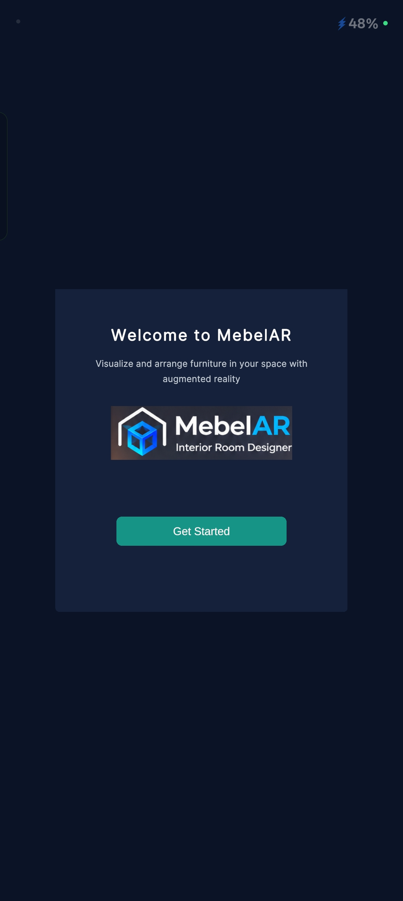
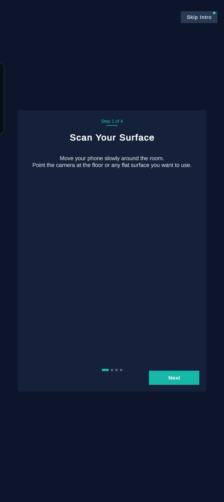
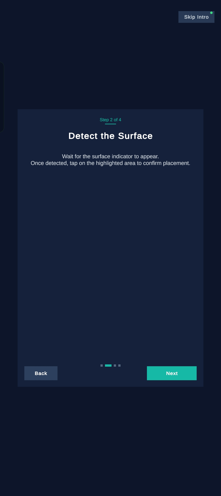
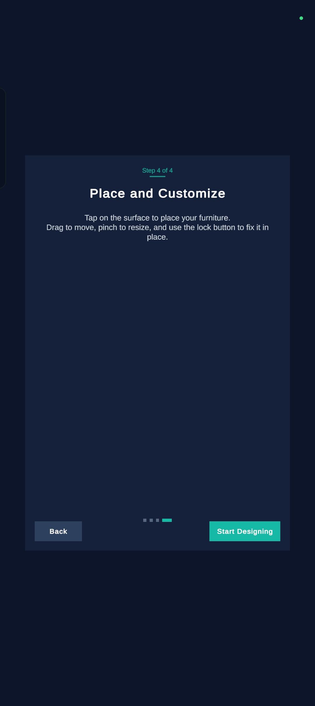
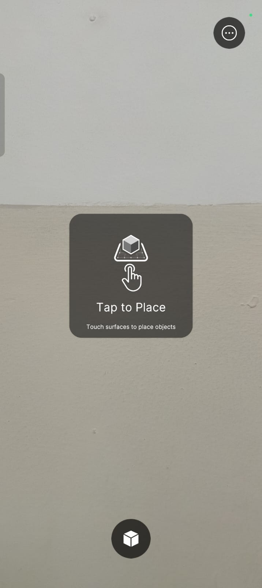
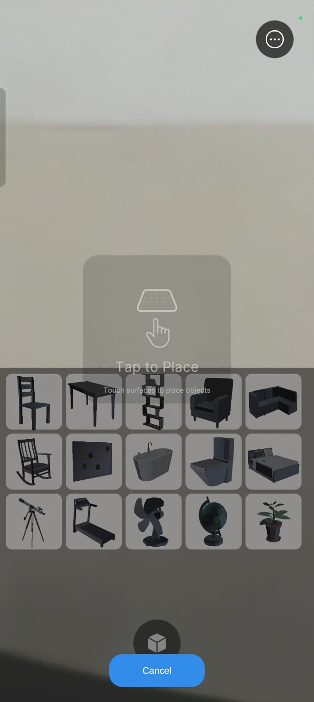
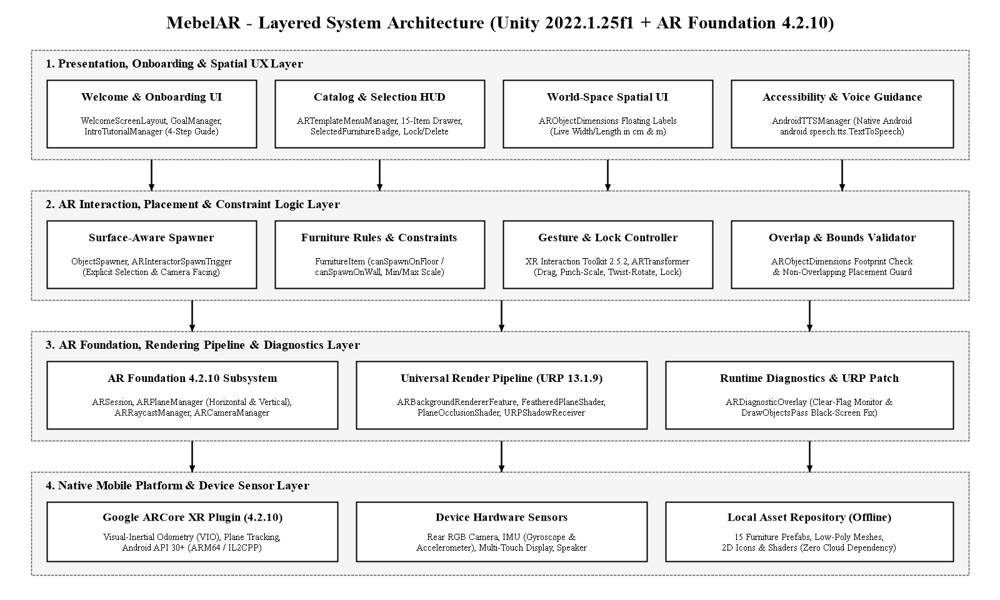
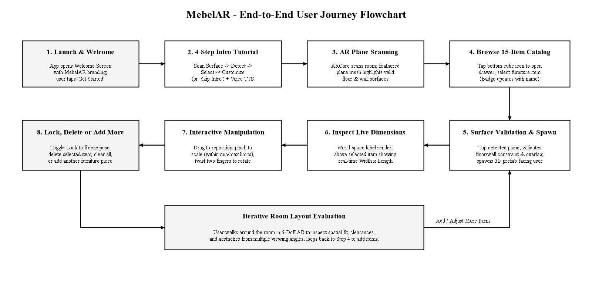

# MebelAR — Augmented Reality Furniture Visualizer

[](https://unity.com/)
[](https://unity.com/srp/Universal-Render-Pipeline)
[](https://docs.unity3d.com/Packages/com.unity.xr.arfoundation@4.2/manual/index.html)
[-brightgreen.svg?logo=android)](https://developers.google.com/ar)
[-informational.svg)](#team--credits)

**MebelAR** is an offline-first Android Augmented Reality (AR) mobile application built with Unity that enables users to preview, place, measure, and arrange realistic 3D furniture models directly inside their physical rooms in real time.

---

## Project Overview

Conventional 2D furniture catalogs fail to convey true physical volume, walkway clearances, and wall alignment. **MebelAR** solves this by anchoring true-to-scale 3D furniture onto live camera feeds using Visual-Inertial Odometry (VIO) and multi-surface plane detection.

- Detects both **horizontal planes** (floors, tabletops) and **vertical planes** (walls) using ARCore.
- Enforces **surface-aware placement constraints** (e.g., sofas and beds on floors, sticky notes boards on walls).
- Provides **live physical dimension labels** (Width × Length in cm and meters), **footprint overlap prevention**, **per-category scale limits**, **per-object Pose Lock**, and **native Android Text-to-Speech (TTS) voice coaching**.

---

## Visual Showcase

### 1. Welcome Screen & 4-Step Guided Onboarding

| Welcome Screen | Step 1: Scan Surface | Step 2: Detect Plane | Step 3: Select Item | Step 4: Place & Lock |
| :---: | :---: | :---: | :---: | :---: |
|  |  |  |  |  |

### 2. Live AR Session, 15-Item Catalog & Real-World Placement

| Tap to Place Coaching | 15-Item Furniture Catalog | Single-Item Placement | Multi-Object Room Layout |
| :---: | :---: | :---: | :---: |
|  |  |  |  |

---

## System Architecture & User Flow

### Layered System Architecture


### End-to-End User Journey


---

## Key Features

- **Multi-Surface Plane Detection**: Real-time horizontal and vertical plane detection rendered with `FeatheredPlaneShader.shader` and `PlaneOcclusionShader.shader`.
- **15-Item Curated 3D Furniture Catalog**:
  - **Living & Dining**: Master Sofa, Single Sofa, Rocking Chair, Wooden Chair, Wooden Table.
  - **Bedroom & Decor**: Bed, Plant Pot, Desk Fan.
  - **Study & Office**: Telescope, Globe, Shelf, Sticky Notes Board (wall-mounted).
  - **Bathroom & Home Gym**: Bath, Toilet, Treadmill.
- **Constraint-Aware Placement & Guardrails**:
  - **Floor vs. Wall Validation** (`FurnitureItem.cs` & `ObjectSpawner.cs`) with explicit catalog selection (`requireExplicitSelection = true`).
  - **Live Physical Dimensions** (`ARObjectDimensions.cs`): Floating billboarded world-space TextMeshPro labels showing real-time Width × Length.
  - **Scale Clamping & Overlap Prevention**: Per-category minimum scale bounds (`0.35x`–`2.0x`) and footprint-radius collision validation.
  - **Per-Object Pose Lock**: One-tap Lock/Unlock checkbox disables `XRGrabInteractable` position, rotation, and scale tracking on finalized items.
- **Native Android Voice Guidance (`AndroidTTSManager.cs`)**: Direct JNI bridge to `android.speech.tts.TextToSpeech` for spoken AR coaching cues with zero static audio file bloat.
- **URP 13 Runtime Clear-Flag Fix (`ARDiagnosticOverlay.cs`)**: Resolves the URP 13.1.9 defect where `DrawObjectsPass` cleared the color buffer to black after `ARCameraBackground` blitted the camera feed.
- **Automated Editor QA Suite (`FeatureValidationTest.cs`)**: 8 NUnit test groups validating HUD anchors, nested prefab display-name resolution, Lock/Unlock pose blocking, and non-overlapping Welcome Screen layout.

---

## Tech Stack

| Category | Technology / Package | Version / Spec |
| :--- | :--- | :--- |
| **Game Engine** | Unity Editor | `2022.1.25f1` |
| **Render Pipeline** | Universal Render Pipeline (URP) | `13.1.9` |
| **AR Framework** | Unity AR Foundation | `4.2.10` |
| **Platform XR SDKs** | Google ARCore / Apple ARKit XR Plugin | `4.2.10` |
| **Interaction & Input** | XR Interaction Toolkit (`2.5.2`), Input System (`1.7.0`) | Screen-space multi-touch gestures |
| **UI & Voice** | Unity uGUI (`1.0.0`), TextMesh Pro (`3.0.6`), Android TTS (JNI) | Responsive HUD & native voice cues |
| **Scripting & QA** | C# (.NET Standard 2.1), Unity Test Framework (`1.1.33`) | 17 custom scripts + 8 Editor tests |
| **Target Device** | ARCore-Supported Android Smartphone | Android 11+ (API 30+), ARM64 / IL2CPP |

---

## Repository Structure

```plaintext
MebelAR/
├── Assets/
│   ├── Editor/                           # AndroidBuildTool.cs, FeatureValidationTest.cs, WelcomeScreenEditorTool.cs
│   ├── Furniture Item Prefabs/           # 15 furniture prefabs + Base Interactable / Floor / Wall variants
│   ├── MobileARTemplateAssets/
│   │   ├── Scripts/                      # ARTemplateMenuManager, ARObjectDimensions, ARDiagnosticOverlay,
│   │   │                                 # AndroidTTSManager, GoalManager, IntroTutorialManager, WelcomeScreenLayout
│   │   ├── Shaders/                      # PlaneOcclusionShader, URPShadowReceiver, ShadowReceiver
│   │   └── UI/                           # CutoutMaskUI, sprites, animations
│   ├── Samples/XR Interaction Toolkit/   # FurnitureItem.cs, ObjectSpawner.cs, ARInteractorSpawnTrigger.cs
│   ├── Scenes/SampleScene.unity          # Main AR Foundation + URP production scene
│   ├── Settings/                         # URP renderer assets & quality profiles
│   └── Sprites/                          # 15 furniture catalog thumbnail icons
├── docs/
│   ├── report/
│   │   └── MebelAR_AR_Project_Report.docx      # Formal AR Project Report (CSE3728)
│   ├── presentation/
│   │   └── MebelAR_AR_Presentation.pptx        # Final AR Evaluation Presentation
│   ├── images/                                 # On-device UI, onboarding & live AR captures
│   └── diagrams/                               # System architecture, user journey & pipeline diagrams
├── Packages/manifest.json                # Unity package dependencies
├── ProjectSettings/                      # XR Plug-in Management, Android API 30+ & URP configuration
├── .gitignore                            # Unity & Android keystore exclusion rules
└── README.md                             # Project documentation
```

---

## Documentation & Deliverables

- **Formal Project Report**: [docs/report/MebelAR_AR_Project_Report.docx](docs/report/MebelAR_AR_Project_Report.docx)
- **Final Presentation Deck**: [docs/presentation/MebelAR_AR_Presentation.pptx](docs/presentation/MebelAR_AR_Presentation.pptx)

---

## Getting Started & Building for Android

### Prerequisites
- **Unity Editor** `2022.1.25f1` with **Android Build Support** (Android SDK, NDK, OpenJDK).
- An **ARCore-supported Android device** running **Android 11 (API Level 30)** or higher with USB Debugging enabled.

### Setup & Build Steps
1. **Clone the repository**:
   ```bash
   git clone https://github.com/projectsbydevgupta/MebelAR.git
   cd MebelAR
   ```
2. **Open in Unity Hub**: Add the `MebelAR` folder using Unity `2022.1.25f1`.
3. **Run Automated Validation (Optional)**: In Unity, click **MebelAR → Run Feature Validation** to run all 8 tests in `FeatureValidationTest.cs`.
4. **Build Android APK**:
   - Open `Assets/Scenes/SampleScene.unity`.
   - Verify **Edit → Project Settings → XR Plug-in Management → Android → Google ARCore** is enabled and **Scripting Backend = IL2CPP (ARM64)**.
   - Use **File → Build Settings → Android → Build and Run** (or run `AndroidBuildTool.cs`).

---

## Security & Offline Privacy

- **100% Offline Execution**: All 3D models, shaders, ARCore tracking, and Android TTS narration execute locally on-device. Zero camera frames are recorded or transmitted to external servers.
- **No Hardcoded Secrets**: No API keys or backend credentials are required; Android release keystores (`*.keystore`, `*.jks`) are excluded via `.gitignore`.

---

## Team & Credits

**Course**: Augmented Reality, Virtual Reality and Immersive Experience Design (`CSE3728`)  
**Institution**: Department of Computer Science and Engineering, School of Engineering and Technology, BML Munjal University  
**Mentor**: Mr. Vivek Tyagi

**Team Members**:
- Ritik Chahar
- Aditya Agrawal
- Astitva
- Dev Gupta
- Prashant
